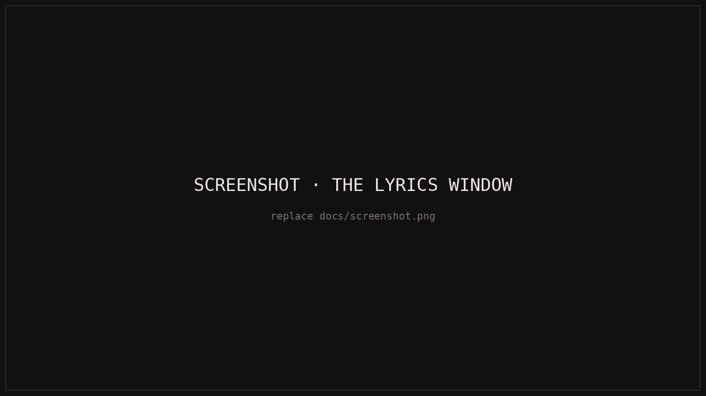
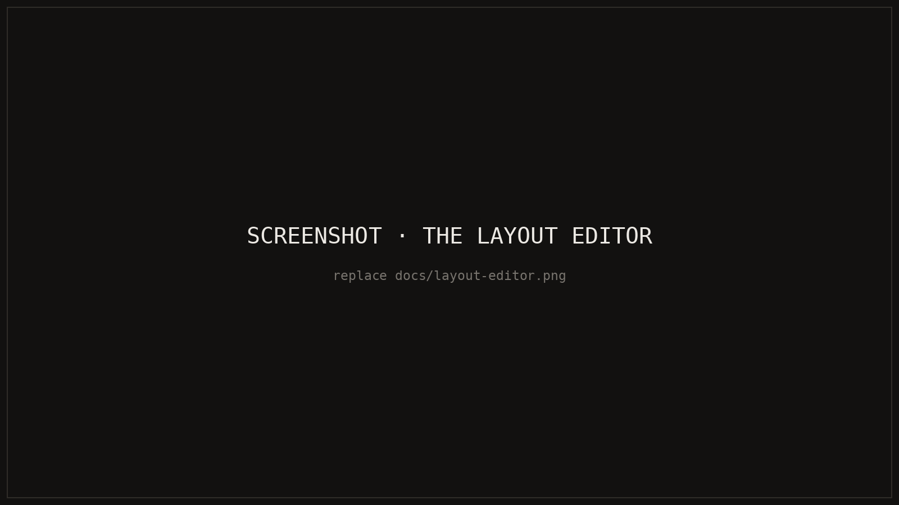
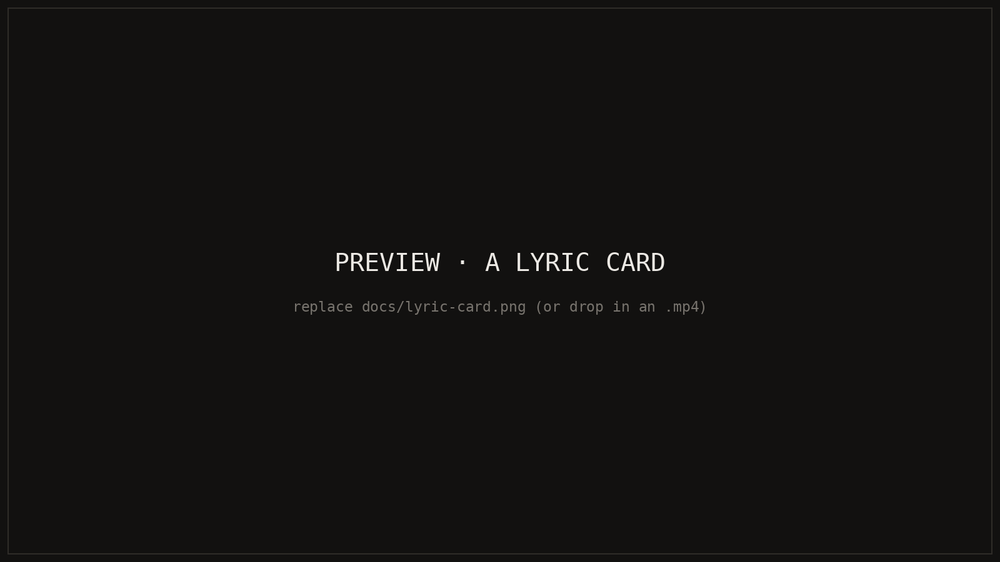

<picture>
  <source media="(prefers-color-scheme: dark)" srcset="docs/banner-dark.gif">
  
</picture>

A small Windows window that shows Spotify lyrics in time with the music, so they can stay on screen while I work.

[Write-up](https://nafthan.co.uk/projects.html?open=kairos) · [Changelog](CHANGELOG.md)

## About

I listen to music most of the day, and I like following the lyrics, but Spotify's own lyrics view takes over the whole app. I wanted the lyrics in a small window that sits on top of whatever I'm doing, with the line being sung kept in the middle, and nothing else in the way.

The name comes from the Greek idea of *kairos*, the right moment, as opposed to *chronos*, clock time. That's the whole job: show the right line at the right moment.

The one decision that shaped it: no third-party packages. Everything is built on what Windows already has, from its media controls and audio system to its own video encoder, so Kairos is a single small program with nothing else to install.

## Features

- Lyrics that follow the song, with the current line centred and highlighted, and a click on any line to jump to it
- Fully customisable: fonts, colours, glow, karaoke fill, focus blur and a beat pulse, with themes I can save and switch between
- Backgrounds: a colour, my own picture or GIF, the album art, or a colour dance that moves with the music
- A layout editor, where I drag the lyrics, title, album cover and profile picture anywhere in the window
- Mini mode, a subtitle-style strip with just the line being sung
- Click-through, so the window never gets in the way, and it fades out while a full-screen app is on the same screen
- Lyric cards: share a line or a few as a picture, a GIF, or an MP4 with the song playing
- My own lyrics for songs the online library doesn't have, with a tap-along tool to time them
- Spotify extras: add the song to a playlist or Liked Songs, browse playlists, search, and control Spotify's volume
- Listening statistics, kept only on my PC

<table>
  <tr>
    <td width="50%"></td>
    <td width="50%"></td>
  </tr>
</table>

## Getting started

Kairos isn't available to download yet. I'm sharing the code so you can see how it's put together.

### Requirements

- Windows 10 (version 2004 or later) or Windows 11
- The .NET 10 Desktop Runtime
- The Spotify desktop app
- For the playlist features: Spotify Premium and your own free Spotify developer app

## Usage

Play a song in Spotify and the lyrics appear. Hover over the window for its controls, and right-click for quick options.

| Key or action | What it does |
|---|---|
| Click a line | Jumps to that point in the song |
| Scroll | Browses the lyrics; `Esc` goes back to the current line |
| `Space` | Play or pause |
| `[` and `]` | Lyrics a little later or earlier |
| `Ctrl` + `+` / `−` | Larger or smaller text |
| `Ctrl` + scroll | Spotify's volume |
| `Ctrl` + `,` | Settings |
| `Ctrl` + `Alt` + `C` | Centres the window left to right, from any app |
| `Ctrl` + `Alt` + `M` | Mini mode on or off, from any app |
| `Ctrl` + `Alt` + `T` | Click-through on or off, from any app (hold `Ctrl` to use the window) |

## How it works

Windows already knows what Spotify is playing and how far through the song it is, through the same media controls behind the volume overlay. Kairos reads that, keeps its own clock between updates so the highlight moves smoothly, and looks the lyrics up in my own lyrics folder first, then on [LRCLIB](https://lrclib.net), a free, open library of time-synced lyrics. Spotify doesn't let other apps use its own lyrics.

| Part | What it does |
|---|---|
| `MediaWatcher.cs` | Follows what's playing and where, through Windows' media controls |
| `LyricsService.cs`, `LocalLyrics.cs` | Finds lyrics: my folder first, then LRCLIB, with a cache |
| `MainWindow.xaml(.cs)` | The lyrics window: following the song, effects, menus and shortcuts |
| `LayoutEngine.cs`, `LayoutEditor.cs` | Places the lyrics, title and pictures, and the drag-and-drop editor for them |
| `BackgroundLayer.cs`, `ImageProcessor.cs` | Backgrounds: pictures, GIFs, album art and the colour dance |
| `SpotifyClient.cs` | The optional Spotify connection, for playlists, search and Liked Songs |
| `SpotifyApp.cs`, `AudioMixer.cs` | Opening, hiding and closing Spotify alongside Kairos, and its volume |
| `LyricCard.cs`, `GifEncoder.cs`, `Mp4Writer.cs`, `AudioRecorder.cs` | Lyric cards, and writing them out as GIFs and MP4s with the song's sound |
| `SettingsWindow.xaml(.cs)`, `LivePreview.cs` | Settings, with a live preview playing a sample song |

## Security and privacy

- Settings, themes, my lyrics and listening statistics are stored only on my PC, in `%APPDATA%\Kairos`.
- Song titles and artists are sent to LRCLIB to look up lyrics. With the Spotify connection on, requests go to Spotify's own Web API.
- The Spotify sign-in uses my own developer app, so my password never passes through Kairos, and the sign-in is stored encrypted so only my Windows account can read it.
- Nothing is collected: no accounts, analytics or tracking of any kind.

## Limitations

- It only works with the Spotify desktop app, not the web player, because it relies on Windows' media controls.
- Lyrics come from LRCLIB, so some songs have none, or plain lyrics without timings. I can add my own and time them.
- Spotify Canvas videos aren't available to other apps, so the album art background is the closest I can get.
- The playlist features need Spotify Premium and a developer app of your own, because of how Spotify limits its Web API.
- Recording a song's sound for a lyric card video happens in real time, and Spotify's terms don't allow apps to record its audio, so it's for my own clips only.
- Kairos isn't signed by a publisher, so Windows shows a warning the first time it runs.

## Licence

All rights reserved. The code is here to read, but not to copy, use or share without asking. See [LICENSE](LICENSE).

<a href="https://nafthan.co.uk">nafthan.co.uk</a>

